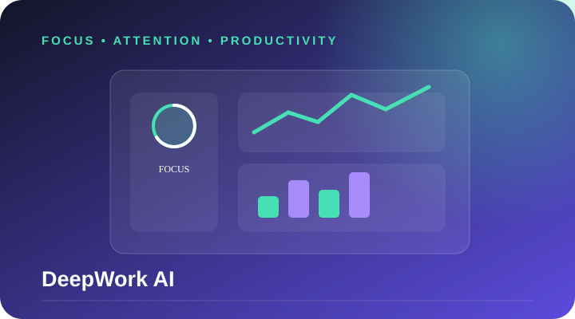
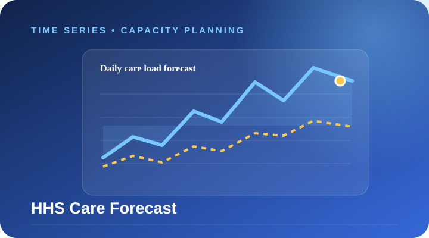
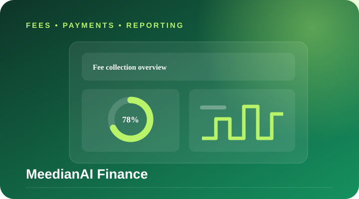
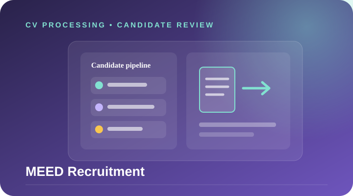

# Nafis Aslam

### Full-Stack Developer · Applied AI/ML Engineer · Software Engineer

**Open to Kuwait-based opportunities**  
Building web applications, data-driven tools, and practical AI systems from idea to deployment.

---

## About

I’m a software developer and computer science graduate with hands-on experience building full-stack web applications, data dashboards, and computer-vision/AI prototypes. I enjoy working across the stack: shaping a user workflow, building the interface and APIs, connecting databases and external services, and documenting how to run the result.

I hold a BSc in Computer Science from Universiti Sains Malaysia and have completed MITx MicroMasters coursework in Statistics and Data Science. I’m seeking opportunities in Kuwait where I can contribute as a:

- Full-Stack Developer / Software Engineer
- Frontend or Backend Developer
- Applied AI / Machine Learning Engineer
- Python Developer or Data/ML Engineer
- Junior Software Engineer / Graduate Technology Associate

I’m open to product teams, enterprise software, education technology, and AI-enabled applications.

## What I bring

- **Full-stack delivery:** React/Next.js interfaces, server-side routes and APIs, PostgreSQL data models, authentication, and integrations.
- **Applied AI/ML:** Python, scikit-learn, PyTorch, computer vision, model evaluation, and AI features inside usable applications.
- **Data applications:** Streamlit dashboards, forecasting workflows, preprocessing, feature engineering, and model comparison.
- **Product-minded engineering:** Experience turning real school and operational workflows into software for users, managers, and administrators.
- **Research and communication:** Final-year research project, technical documentation, and a peer-reviewed preprint record.

## Selected projects

<table>
<tr>
<td width="50%" valign="top">

<h3>DeepWork AI</h3>

AI-assisted focus and productivity app combining focus sessions, goals, analytics, and privacy-conscious webcam attention signals.

<strong>Tech:</strong> Next.js, Flask, Python, PostgreSQL, YOLO, MediaPipe, OpenCV, PyTorch 
<a href="https://github.com/NafisAslam70/DeepWorkAI">Repository</a> · <a href="https://deep-work-ai-nu.vercel.app">Live app</a> · <a href="https://youtu.be/Je0_qLxRbX8">Demo</a> · <a href="https://doi.org/10.5281/zenodo.19266394">Research</a>

</td>
<td width="50%" valign="top">

<h3>MeedianAI Flow v2</h3>

A role-based workspace for school and community operations, including schedules, tasks, attendance, messaging, approvals, and reporting.

<strong>Tech:</strong> Next.js, React, PostgreSQL, Drizzle ORM, Prisma, Redis, NextAuth 
<a href="https://github.com/NafisAslam70/MeedianAI-Flow-v2">Repository</a>

</td>
</tr>
<tr>
<td width="50%" valign="top">

<h3>HHS Care Forecast Dashboard</h3>

Interactive comparison of baseline, Random Forest, and SARIMA forecasts for care load and discharge demand, with capacity-pressure indicators.

<strong>Tech:</strong> Python, pandas, scikit-learn, statsmodels, Streamlit 
<a href="https://github.com/NafisAslam70/UF-Internship-hhs-care-forecast">Repository</a>

</td>
<td width="50%" valign="top">

<h3>MEED International School Website</h3>

Multilingual school website and admissions experience with content-management workflows and enquiry capture.

<strong>Tech:</strong> Next.js, React, Sanity, PostgreSQL, Drizzle ORM 
<a href="https://github.com/NafisAslam70/meedSchoolWeb">Repository</a>

</td>
</tr>
<tr>
<td width="50%" valign="top">

<h3>MeedianAI Finance</h3>

School finance app for fee collection, dues, payment tracking, transport charges, spreadsheet imports, and reporting.

<strong>Tech:</strong> React, TypeScript, Vite, Express, PostgreSQL, Drizzle ORM 
<a href="https://github.com/NafisAslam70/MeedianAI-Finance">Repository</a>

</td>
<td width="50%" valign="top">

<h3>MEED Recruitment</h3>

Recruitment portal with application forms, PDF CV parsing, OCR/text extraction, and candidate review workflows.

<strong>Tech:</strong> Python, Flask, pdfplumber, Tesseract OCR, spaCy 
<a href="https://github.com/NafisAslam70/meed-recruitment">Repository</a>

</td>
</tr>
</table>

[Browse all repositories](https://github.com/NafisAslam70?tab=repositories)

## Technical skills

**Languages:** Python, JavaScript, TypeScript, SQL  
**Frontend:** React, Next.js, HTML, CSS, Tailwind CSS  
**Backend:** Flask, Node.js, Express, REST APIs  
**AI / data:** PyTorch, scikit-learn, YOLO, MediaPipe, OpenCV, pandas, Streamlit  
**Databases / tools:** PostgreSQL, Drizzle ORM, Prisma, Git, GitHub  
**Cloud / integrations:** Vercel, Neon, Clerk, Sanity, Cloudinary, Twilio

## Education and experience

| Period | Experience |
|---|---|
| 2026–present | Computer Vision Lab Fellow — WorldQuant University |
| 2025–2026 | Internship — Indian Statistical Institute (ISI) |
| 2024–2025 | DeepWork AI / DeepLens Engine for Focus — Final Year Project and research |
| 2024–2025 | MITx MicroMasters coursework — Data Analysis and Machine Learning |
| 2021–2025 | BSc Computer Science — Universiti Sains Malaysia; GPA 3.82, Dean’s List three times |
| 2018–2022 | Superintendent — Meed Public School |

## Research

**DeepLens Engine for Focus: A Multi-Layered Framework for Real-Time Attention Monitoring in Productivity Environments**

[Read the preprint](https://doi.org/10.5281/zenodo.19266394)

## Contact

I’m open to software engineering, full-stack, applied AI/ML, and related technology opportunities in Kuwait.

- **Email:** [nafisaslam1819@gmail.com](mailto:nafisaslam1819@gmail.com)
- **LinkedIn:** [linkedin.com/in/nafis-aslam](https://www.linkedin.com/in/nafis-aslam/)
- **Portfolio:** [nafisaslam.com](https://nafisaslam.com)
